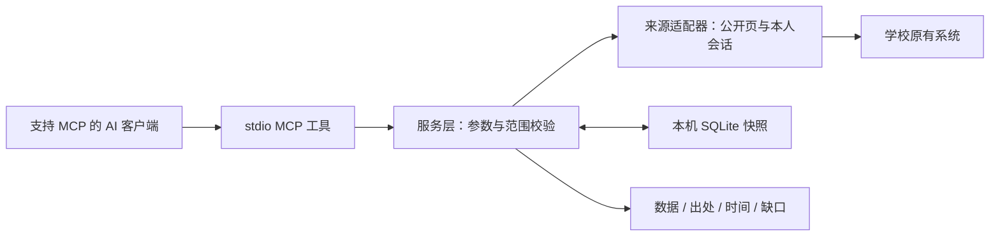

# 我的商大 MCP

**把分散的校园入口，变成可以直接提问的只读工具。**

面向浙江工商大学「我的商大」及相关校园系统的个人 MCP 服务。
你在支持 MCP 的 AI 客户端里提问，由客户端选择工具，读取本人有权访问的数据并整理回答。

`Python 3.12+` · `MCP / stdio` · `SQLite 本地缓存` · `48 个注册工具` · `421 项合成测试` · [MIT License](LICENSE)

> **公开版本：48 个注册工具。** 新增查询本地公众号订阅库的 `get_mp_articles`；原有培养方案、寝室电表及图书馆余座入口等能力继续保留。注册数不等于学校信息覆盖率或全部业务验收通过。
> 本项目为个人开发实践，不代表学校官方产品或官方开放 API。

> **验证与限制：** 原项目和公开副本各通过 `421` 项合成回归；新工具分别通过实际 stdio 的分页与缺库合成检查。先前的 399 项回归、47 工具及七次 stdio 合成调用为历史记录。本轮未新增实账号或 WorkBuddy 端到端验收。详见[验证记录](docs/validation.md)。

[快速开始](docs/quickstart.md) · [工具索引](docs/tool-reference.md) · [实现原理](docs/architecture.md) · [已知限制](docs/limitations.md) · [验证记录](docs/validation.md)

成绩总表、成绩明细、两种课表及考试已加入60秒短时复用；要最新可要求强制刷新。重载MCP后生效，行为与实测边界见[查询提速](docs/performance.md)。

需要减少会话过期后的人工登录，可在本人终端显式运行 `login_cli cred-save` 或 `init --save-cred`，开启本机凭据恢复。**默认不保存密码；开启后密码为本机明文 JSON**，不写进 MCP 配置或工具参数。统一会话失效时自动重登并重试一次，独立体测令牌仍单独导入；失败如实保留。用法、180天默认时效、清除和退出语义见[自动恢复教程](docs/quickstart.md#可选保存凭据并自动恢复)。

查询本学期修读课程学分时，网页课表会同时返回同一完整本地快照的已知学分小计、缺口及分段耗时，减少额外探查课程库和培养方案。小计仍以课表可见范围为限。

## 为什么做这个

查课表、成绩、考试、通知和学校规定，往往需要切换 App、网页和多个子系统。
这个项目希望减少找入口、重复跳转和手工整理：保留学校原有权限，在个人电脑上把可读信息接成统一工具。

MCP 可以理解为 AI 客户端与校园查询程序之间的标准连接方式。
本仓库提供查询程序，AI 客户端负责理解自然语言、选择参数和组织回答；程序本身不内置大模型。

## 可以怎样问

```text
今天有没有宣讲会？列出时间、地点和来源。
查我指定学期的考试安排。
查本学期成绩，并说明是否已经读完所有页面。
最近有哪些奖学金公示？打开其中一条正文。
本地已订阅的公众号最近记录了哪些文章？
劳动教育现在有哪些课程？查看其中一门的详情。
学生手册对我关心的事项怎么规定？给出出处和版本。
图书馆有哪些中文期刊资源？
我提交的流程目前是什么状态？只查询，不处理。
```

部分问题需要本人有效会话；未接通、权限拒绝和读取失败应如实说明。
来源失败不能回答成「没有记录」，只读列表也不能当作完整历史。

## 功能概览

| 业务组 | 工具数 | 当前接入内容 |
| --- | ---: | --- |
| 教务与学业 | 23 | 课表、考试、成绩/明细、课程目录、教学计划、培养方案附件正文、学业信息等 |
| App 服务 | 2 | 校园服务目录、本人消息 |
| 公开信息 | 9 | 宣讲会、招聘信息、通知、新闻、教师主页、图书馆公开信息与书目检索 |
| 学生成长 | 6 | 体测成绩/时段、劳动课程/详情、学生手册、综测入口状态 |
| 流程与资源 | 5 | 本人流程列表、公开奖学金公示、图书馆数字资源、余座人工入口、寝室电表 |
| 本地订阅 | 1 | 本机公众号订阅库的文章查询 |
| 辅助 | 2 | 能力清单、来源健康状态 |

完整名称和参数见[工具索引](docs/tool-reference.md)。同一组中的不同来源有独立的认证和覆盖范围。

上表合计 48 个注册工具。公众号工具只查询配置的本地订阅库，不代表学校全部公众号；记录时间可能是采集时间，最新成功采集时间未知。[配置与限制](docs/tool-reference.md#get_mp_articles)。培养方案正文需有效教务会话并精确匹配方案和年级；电表需本人核实的定位配置；余座默认提供官方人工入口。

**仍有缺口：**综测业务结果映射、部分附件格式和文本完整性，以及本人劳动非空时数/完成记录的真实对照等。
部分历史正文、详情和分页分支仍有限定使用说明，见[限制清单](docs/limitations.md)。

## 快速开始

推荐先连接公开查询，确认客户端能发现工具，再按需要配置本人认证。

### 1. 准备本地环境

需要 Python 3.12 或更新版本，以及支持本地 stdio MCP 的客户端。
App 登录中的 Java 加密桥还需要完整 JDK；本次本地测试使用 JDK 21。

```powershell
git clone https://github.com/Yingye66/zjgsu-campus-mcp-open-source.git
cd zjgsu-campus-mcp-open-source
python -m venv .venv
& .\.venv\Scripts\python.exe -m pip install -r requirements.txt
```

本仓库公开可克隆；个人查询仍需要使用者自己的合法账号和本机配置。
依赖版本来自本次验证环境；尚未声称所有系统和全新网络环境都已安装验证。

### 2. 配置 MCP 客户端

将 [examples/mcp-config.example.json](examples/mcp-config.example.json) 中的路径替换为你本机的绝对路径，合并到客户端已有配置：

```json
{
  "mcpServers": {
    "zjgsu-campus": {
      "command": "C:/path/zjgsu-campus-mcp-open-source/.venv/Scripts/python.exe",
      "args": ["-m", "src.mcp_server.server"],
      "env": {
        "PYTHONPATH": "C:/path/zjgsu-campus-mcp-open-source",
        "ZJGSU_CAMPUS_DATA_DIR": "C:/path/private-campus-data"
      }
    }
  }
}
```

保存后重载该 MCP，先问一条公开问题，例如「查最近的奖学金公示并给出处」。
MCP 客户端会启动服务进程，不需要额外启动一个后台 Web 服务。

### 3. 按需建立本人会话

**公开查询不要求先登录学校。**个人课表、成绩等需要对应学校会话。
私有认证还需要本机合法取得的客户端配置，仓库不提供实际常量、Cookie、token 或反编译产物。
具体前提和步骤见[认证配置](docs/quickstart.md#本人会话)。

```powershell
$env:ZJGSU_CAMPUS_DATA_DIR = "C:/path/private-campus-data"
& .\.venv\Scripts\python.exe -m src.auth.login_cli init
```

只在本人交互式终端输入凭据。App 登录成功不等于教务 CAS 已成功；体测专用令牌也是独立流程。
没有对应私有配置时，先使用公开能力，不要反复登录或把凭据交给 AI。

## 怎么判断回答是否可信

工具除了数据，还返回来源、查询范围、取得时间和缺口：

| 状态 | 应如何理解 |
| --- | --- |
| `ok` | 本次查询按当前契约完成；仍须看覆盖范围，不能自动等同全量 |
| `partial` | 只有部分结果，或保留了先前的成功快照；应说明缺口与时间 |
| `unavailable` | 当前无法获取，例如缺会话、来源拒绝、网络或结构异常 |

只有来源成功、范围一致且有足够完整性证据，才能把空结果解释为「该来源中没有找到」。

## 实现结构



认证 CLI 与 MCP 查询协议分离；账号和查询范围用于隔离本地快照。
学校系统的权限、开放周期和网络条件仍然有效。详见[架构说明](docs/architecture.md)。

## 开发与测试

```powershell
& .\.venv\Scripts\python.exe -m pip install -r requirements-dev.txt
& .\.venv\Scripts\python.exe -m unittest discover -s test -t . -v
```

原项目和公开副本各通过 `421` 项合成回归。测试使用合成认证/来源和临时数据库；工具注册、契约测试与真实业务可用性分别记录。
脱敏发布副本的最终结果见[验证记录](docs/validation.md)，不以本地测试代替真实学校账号或客户端界面验收。

## 范围与隐私

- 只查询，不代报名、签到、预约、支付、续借、提交或审批。
- 本人借阅已经取消；公开书目检索和图书馆公开信息保留。
- 校园卡与畅约及跳转畅约的入口只作人工导航，不采集相关数据。
- 私人会话与缓存仅保留本机；会话文件目前为明文 JSON，需妥善保护。
- 本仓库不包含原始私人记录、账号配置、学校 APK、反编译产物或历史私人交接。
- 不部署公共代查服务，不共享账号，不绕过权限或平台限制。

## 参与和维护

遇到问题，提供去身份的提问、工具名、日期/学期范围、错误类别和发生时间即可。
不要提交密码、Cookie、token、学号或完整私人回包。参见[贡献说明](CONTRIBUTING.md)与[安全说明](SECURITY.md)。

本项目按实际故障、学校来源变化或明确新需求维护；MCP 查询服务不自动启动监控或持续后台采集。独立的公众号采集器需由使用者自行配置和管理，其行为不受本服务只读保证约束。
本项目源码与随附文档采用 [MIT License](LICENSE)，允许使用、修改和分发，须保留版权与许可声明。依赖及第三方系统资料分别遵循其自身条款；本许可不授予学校数据、账号或受限服务的访问权限。

## 联系作者

| 方式 | 联系方式 |
| --- | --- |
| 微信 | `yingyeyo` |
| QQ 邮箱 | [1958526420@qq.com](mailto:1958526420@qq.com) |
| Gmail | [yingye753@gmail.com](mailto:yingye753@gmail.com) |
